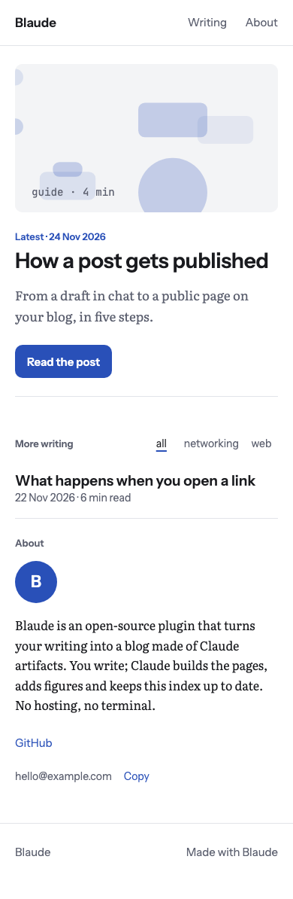
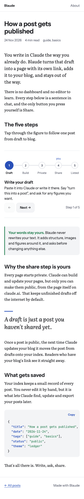
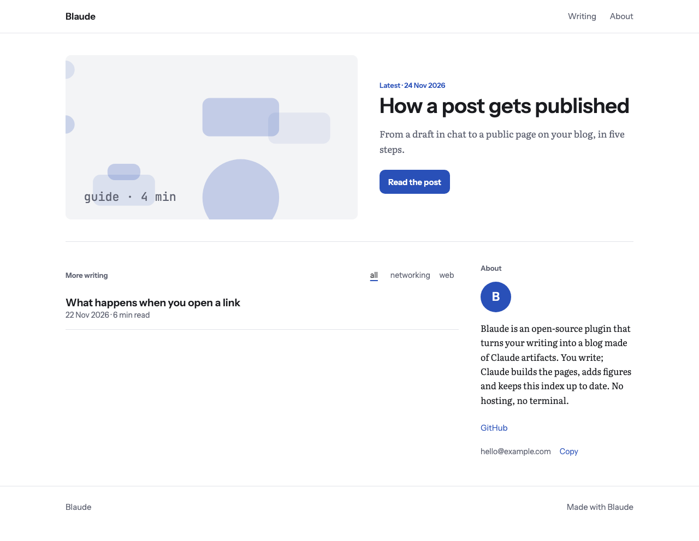
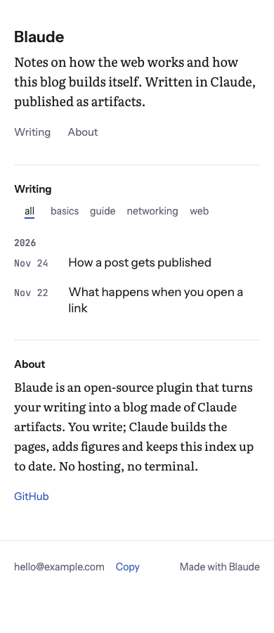
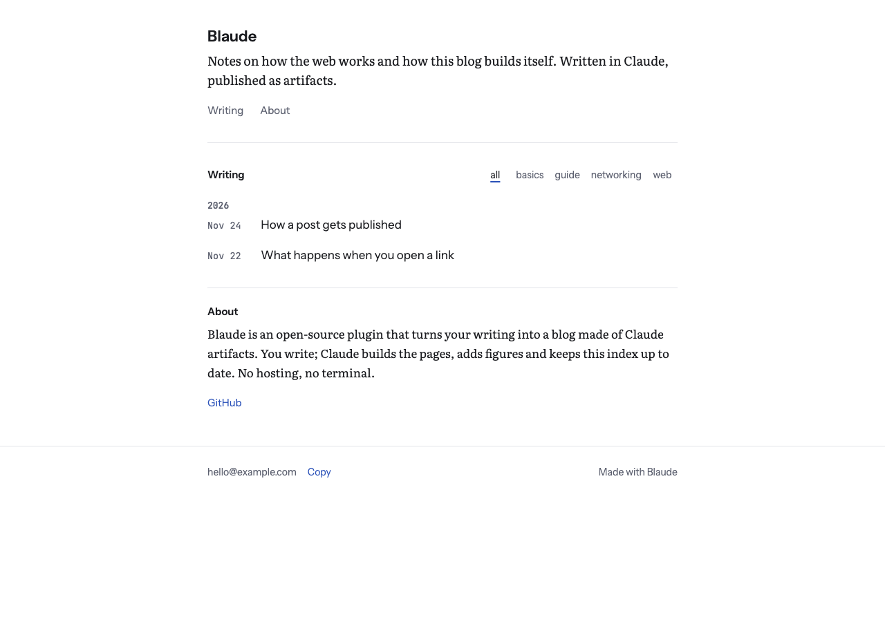

# Theme gallery

Every theme in `skills/blaude/themes`, rendered by `node tools/check-theme.js --gallery` in light mode. The phone shots are 390 px wide; the desktop shots 1280 px.

## Featured (`featured`)

Your latest post shown large with a cover, older posts below. For writers who post less often.

Index layout: featured. By Blaude. [Preview page](../../skills/blaude/themes/featured/preview.html)

| Index, phone | Post, phone | Index, desktop |
| --- | --- | --- |
|  |  |  |

## Ledger (`ledger`)

The default. A contents page: your name, an intro, and posts grouped by year.

Index layout: ledger. By Blaude. [Preview page](../../skills/blaude/themes/ledger/preview.html)

| Index, phone | Post, phone | Index, desktop |
| --- | --- | --- |
|  |  |  |

To add yours, see [CONTRIBUTING.md](../../CONTRIBUTING.md).
